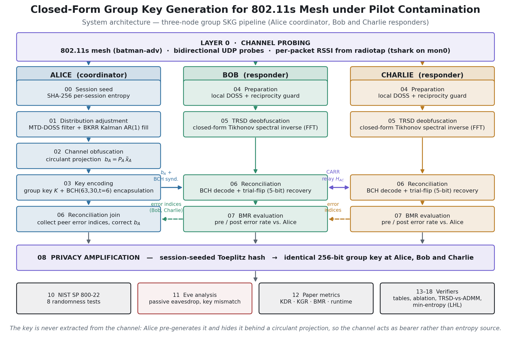
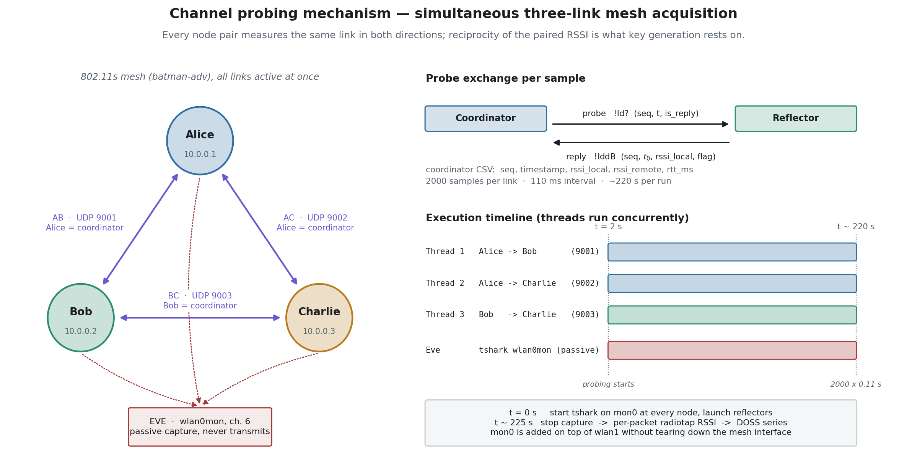

# Closed-Form Group Key Generation for 802.11s Mesh under Pilot Contamination

Physical-layer **group** secret key generation (SKG) across a three-node 802.11s
mesh (Alice, Bob, Charlie), hardened against an Eve that is both a passive
eavesdropper and an active **pilot-contamination** attacker.

The key is never extracted from the channel. Alice pre-generates a 256-bit group
key and hides it behind a circulant projection; the channel carries the key
rather than sourcing its entropy. Peers recover it with **TRSD** — a closed-form
Tikhonov spectral inverse that replaces the iterative ADMM solver used by
comparable schemes.

This repository holds the complete pipeline for all three nodes, the measured
datasets, and the verifier scripts behind every number reported below.

---

## System architecture



Alice runs stages 00–03, waits for both peers, then joins at 06 and finishes at
08. Bob and Charlie run 04–07 independently and exchange over the CARR relay.
All three arrive at the same 256-bit key after privacy amplification.

## Channel probing mechanism



All three links are probed **simultaneously**, one thread per link, on separate
UDP ports so they never collide. RSSI is taken per packet from the radiotap
header via `tshark` on a `mon0` interface added on top of `wlan1` — the mesh
interface is never torn down.

| Link | Coordinator | Reflector | UDP port |
|------|-------------|-----------|----------|
| AB | Alice | Bob | 9001 |
| AC | Alice | Charlie | 9002 |
| BC | Bob | Charlie | 9003 |

Both figures are generated by `python3 docs/make_figures.py` — edit that script,
not the PNGs.

---

## Results

Measured on the ITS Surabaya testbed, 2000 probes per link at 110 ms.

| | exp1 — baseline | exp2 — mobility | exp3 — pilot contamination |
|---|---|---|---|
| Samples after filtering (N) | 2045 | 2029 | 1580 |
| Key length | 256 bit | 256 bit | 256 bit |
| BMR pre-correction | 0.000 % | 0.000 % | 0.000 % |
| BMR post-correction | 0.000 % | 0.000 % | 0.000 % |
| **KDR (Alice ↔ Bob ↔ Charlie)** | **0 %** | **0 %** | **0 %** |
| KGR | 5.449 bit/s | 8.171 bit/s | 8.424 bit/s |
| NIST SP 800-22 | PASS (8/8) | PASS (8/8) | PASS (8/8) |
| Eve KDR | 48.05 % | 54.30 % | 52.34 % |
| Correlation r(Alice, Eve) | −0.0075 | 0.0080 | −0.0148 |

Eve lands at roughly 50 % key disagreement — indistinguishable from guessing —
and her channel estimate is uncorrelated with Alice's, including in exp3 where
she actively injects frames impersonating Alice.

### Novelty stack (each verified at runtime)

1. **TRSD** — closed-form Tikhonov spectral inverse, replacing iterative ADMM.
2. **BKRR** — Kalman AR(1) fill for missing DOSS samples, resistant to adversarial gaps.
3. **MTD-DOSS + reciprocity guard** — pre-filters Eve-contaminated samples before BKRR.
4. **CARR** — Bob falls back to the `H_AC` relay when `H_BA` goes NLOS; this is what carries exp3.
5. **Per-session SHA-256 seed** — random projection and Toeplitz hash differ every session.
6. **Adaptive confidence threshold** — 3σ clipped rather than a fixed constant.
7. **Trial-flip BCH recovery** — flips up to 5 low-confidence bits when BCH decoding fails.

---

## Repository layout

```
alice/      coordinator: stages 00–03, 06, 08 + validation and verifiers 10–18
bob/        responder:   stages 04–08
charlie/    responder:   stages 04–08 (mirrors Bob)
docs/       make_figures.py and the generated PNGs
```

Each node directory carries its own measured data and results:

```
<node>/exp{1,2,3}/doss_<node>.csv        DOSS series used for key generation
<node>/exp{1,2,3}/doss_eve_<node>.csv    the same link as captured by Eve
alice/exp{1,2,3}/skenario{1,2,3}.md      scenario description (Indonesian)
<node>/output/                            per-stage intermediate results
<node>/key/key_<node>_exp{1,2,3}.txt      final 256-bit key, hex
```

`doss_*.csv` columns: `timestamp_unix, t_rel, delta_AB, mtd_delta_AB, delta_AC,
mtd_delta_AC` — `delta_*` is the raw DOSS series, `mtd_delta_*` the same series
after MTD filtering.

### Pipeline stages

| Stage | Alice | Bob / Charlie |
|-------|-------|---------------|
| 00 | session seed (SHA-256) | — |
| 01 | distribution adjustment: MTD-DOSS + BKRR | — |
| 02 | channel obfuscation, circulant projection `b_A = P_A x̃_A` | — |
| 03 | key encoding + BCH(63,30,t=6) encapsulation | — |
| 04 | — | preparation: local DOSS + reciprocity guard |
| 05 | — | TRSD deobfuscation (closed-form, FFT) |
| 06 | reconciliation join | BCH decode + trial-flip recovery |
| 07 | — | BMR evaluation against Alice |
| 08 | privacy amplification (Toeplitz hash) | privacy amplification |
| 10–12 | NIST tests, Eve analysis, paper metrics | — |
| 13–18 | table/ablation verifiers, TRSD-vs-ADMM benchmark, min-entropy (LHL) | — |

---

## Running it

### Requirements

```bash
pip install -r requirements.txt
```

Three Linux nodes on one 802.11s mesh (batman-adv), each with `tshark`,
`iw`, and — for the orchestrator's file transfers — `sshpass` or SSH keys.

### Configuration

No credentials are stored in this repository. Peer addresses and passwords come
from the environment:

```bash
cp .env.example .env      # .env is git-ignored
set -a && source .env && set +a
```

SSH keys are the better option; leave the `*_PASS` values empty when you use
them.

### Re-run the analysis on the shipped data

The measured datasets are committed, so the full pipeline reproduces without any
radio hardware:

```bash
python3 alice/run_all_experiments.py        # all three experiments end to end
python3 alice/10_nist_validation.py exp1    # NIST SP 800-22 on one key
python3 alice/12_paper_metrics.py exp1      # the results table above
python3 alice/16_benchmark_trsd_admm.py     # TRSD vs. ADMM head to head
```

Verifiers `13`–`15` recompute the paper's tables from the committed outputs;
`14` reruns the BKRR and CARR ablations; `18` computes the empirical min-entropy
and leftover-hash-lemma bound.

### Fresh measurement run

Start `09_bob_orchestrator.py` and `09_charlie_orchestrator.py` on the two
responders, then `09_alice_orchestrator.py` on Alice. Alice polls each peer's
output directory and blocks until both publish their stage-06 error indices.

---

## Security notes

- **No credentials in this repository.** SSH hosts and passwords are read from
  environment variables; `.env` is git-ignored and only `.env.example` ships.
- **The committed keys are research artifacts.** `key/key_*_exp*.txt` holds the
  256-bit keys produced by these specific recorded runs — they are the evidence
  the verifier scripts check, and they grant access to nothing. A live
  deployment derives a fresh key per session.
- **Seeds are per-session.** The projection matrix and Toeplitz hash derive from
  a SHA-256 session seed, not a fixed constant, so `P_A` is not reproducible by
  an attacker across sessions.

---

## Citation

```bibtex
@misc{closedform_mesh_skg,
  title  = {Closed-Form Group Key Generation for 802.11s Mesh under Pilot Contamination},
  author = {Riyadh Lakadimu},
  year   = {2026},
  note   = {Source code and datasets}
}
```
